# Data Scientist Challenges

**Una aplicación local que genera, corrige y registra retos de Data Science, y dibuja un mapa de lo que sabes y de lo que te falta.**

Cada reto es multi-etapa, con teoría, ejemplo resuelto, datos sintéticos y un notebook donde resuelves. Agentes de Claude Code (sobre tu suscripción, sin API key) escriben los retos, explican tus errores y leen tus notas; un orquestador local decide, ejecuta el código y es el único que escribe archivos. Con cada intento, tu grafo de conocimiento se actualiza y el siguiente reto se calibra contra tus debilidades reales.

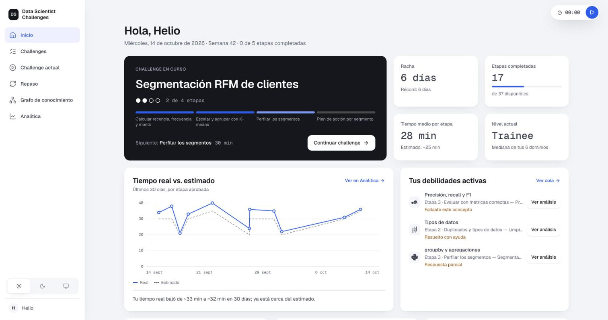

> Proyecto personal de un solo usuario, hecho por **Helio Castillo** para reemplazar su registro manual de «retos diarios» en Notion. Todo corre en tu máquina: sin servidor remoto, sin base de datos y sin autenticación.

## Contenido

1. [Qué problema resuelve](#qué-problema-resuelve)
2. [Un vistazo a la app](#un-vistazo-a-la-app)
3. [Cómo funciona un challenge](#cómo-funciona-un-challenge)
4. [Arquitectura](#arquitectura)
5. [Los tres agentes](#los-tres-agentes)
6. [Verificar una etapa](#verificar-una-etapa)
7. [Pedagogía: Bloom, Apoyo y Nivel](#pedagogía-bloom-apoyo-y-nivel)
8. [El grafo de conocimiento](#el-grafo-de-conocimiento)
9. [Datos y persistencia](#datos-y-persistencia)
10. [Formato de un challenge](#formato-de-un-challenge)
11. [Empezar](#empezar)
12. [Estructura del repositorio](#estructura-del-repositorio)
13. [Cómo se construyó: SDD y estándares](#cómo-se-construyó-sdd-y-estándares)
14. [Costos medidos](#costos-medidos)
15. [Estado y límites](#estado-y-límites)

## Qué problema resuelve

Practicar con ejercicios sueltos no dice dónde estás flojo. Este proyecto convierte la práctica en **evidencia**:

- **Retos completos, no ejercicios.** Un escenario de negocio, datos, varias etapas con distinto nivel cognitivo, preguntas de negocio que respondes en la app y un test final de retención.
- **Corrección real.** Tu celda se ejecuta en Python sobre los datos del reto y se compara con el resultado esperado. Un agente de solo lectura te explica qué pasó, sin darte la solución.
- **Un mapa de lo que sabes.** 241 conceptos en 6 dominios (SQL, Python, Matemática Aplicada, Machine Learning, Limpieza y Visualización, Business Analytics) con 329 relaciones de prerrequisito. El estado de cada concepto sale solo de tus intentos.
- **Práctica calibrada.** El siguiente reto refuerza lo que fallas, avanza por la frontera de tu grafo y sube de dificultad según tu nivel en cada dominio.

## Un vistazo a la app

Seis pantallas más una ventana de análisis por debilidad. Las capturas usan los datos de ejemplo (`?datos=ejemplo`).

| | |
|---|---|
| 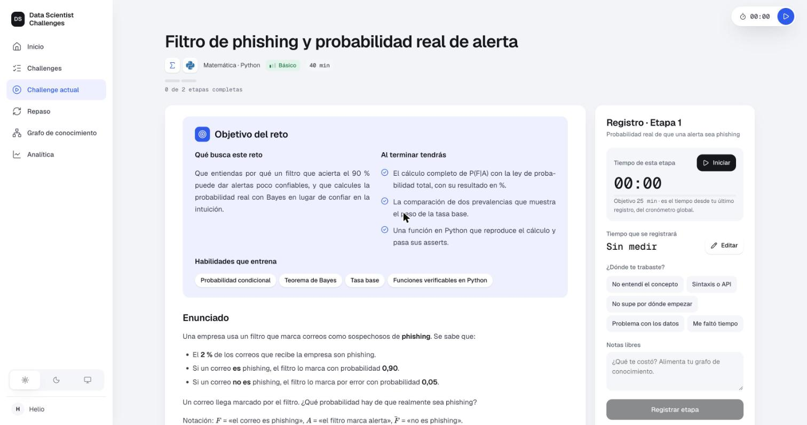 | 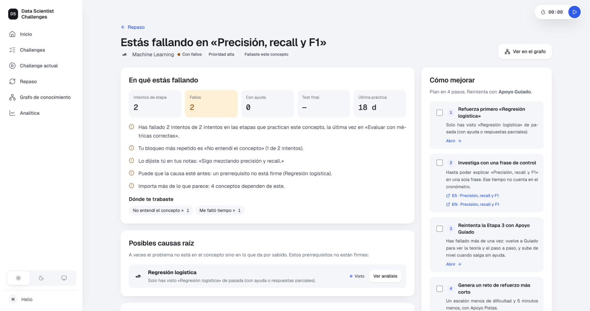 |
| **Challenge actual.** Objetivos, enunciado con LaTeX, datos con diagrama relacional, etapas por Apoyo y un cronómetro global que reparte el tiempo entre etapas. | **Ventana de debilidad.** En qué fallas, con qué evidencia, qué prerrequisito puede estar detrás y cómo mejorar. |
| 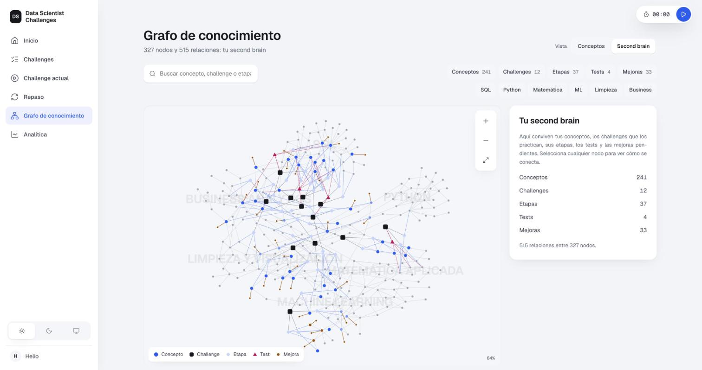 | |
| **Second brain.** Conceptos, challenges, etapas, tests y mejoras en un mapa unificado, con filtros que atenúan sin ocultar. | |

Además: **Challenges** (catálogo con filtros por dominio, dificultad, Bloom y estado, y el diálogo «Generar nuevo challenge»), **Repaso** (cola priorizada de debilidades), **Grafo** (vista por conceptos y vista second brain) y **Analítica** (tiempo real frente a estimado, tendencia de bloqueos, brechas y nivel por dominio). Hay modo claro, oscuro y del sistema.

## Cómo funciona un challenge

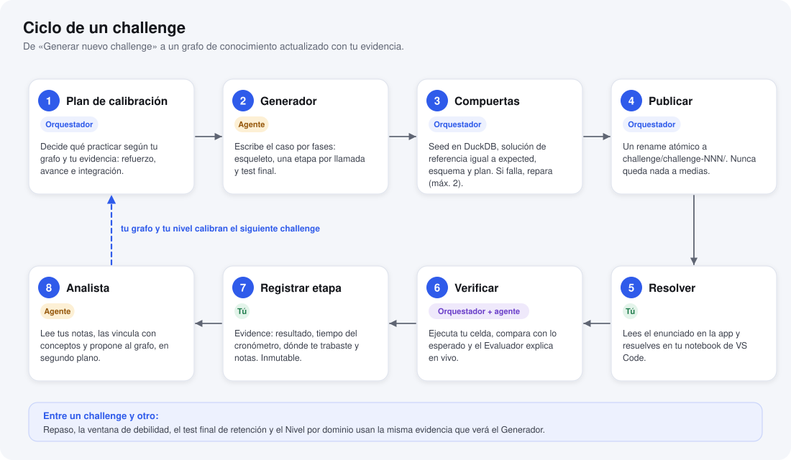

1. **Plan.** El orquestador decide *qué* practicar con una función pura y testeable: una etapa de **refuerzo** (lo primero de tu cola de Repaso, o su causa raíz), una de **avance** (la frontera de tu grafo) y una de **integración** (Business). Con menos de 8 registros entra en modo *arranque*: dificultad básica y todo en Apoyo Guiado.
2. **Generar.** El Generador escribe el caso por fases (esqueleto, una etapa por llamada, test final). No elige conceptos: el plan es un contrato.
3. **Compuertas.** Antes de publicar, el orquestador construye la base DuckDB desde el seed, comprueba lo que el caso declara, ejecuta la solución de referencia y exige que reproduzca el resultado esperado. Si algo falla, se repara hasta 2 veces; si no, no se publica nada.
4. **Resolver y verificar.** Resuelves en tu notebook de VS Code; la app ejecuta solo la celda marcada `# Entregable - Etapa X:`.
5. **Registrar.** «Registrar etapa» crea una *Evidence* inmutable con el resultado, el tiempo y tus notas.
6. **Analizar.** En segundo plano, el Analista lee tus notas y actualiza el grafo con reglas estrictas.

## Arquitectura

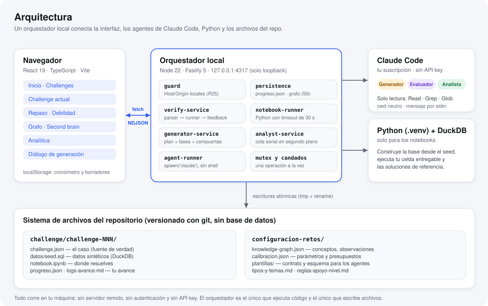

El orquestador (`app/server/`, Fastify sobre Node) es el centro del sistema y el único que ejecuta código y escribe archivos:

| Módulo | Qué hace |
|---|---|
| `guard` | Rechaza cualquier petición cuyo `Host` u `Origin` no sea local (frena el DNS rebinding). |
| `persistence/` | Lee y escribe `progreso.json` y `knowledge-graph.json` con colas por archivo y escritura atómica (tmp + rename). |
| `verify/` | Parser del notebook, runner de Python con timeout y servicio de verificación que emite eventos en vivo. |
| `generator/` | El plan de calibración, el servicio de generación por fases, las compuertas de ejecución y el área de trabajo transaccional. |
| `analyst/` | El núcleo puro que aplica las propuestas del Analista y la cola serial en segundo plano. |
| `agents/` | `spawn('claude', …)` sin shell, mensaje por stdin, solo lectura, sin API key. |

El frontend (`app/web/`) es React 19 con TypeScript y Vite, con CSS plano sobre variables, gráficos SVG propios y Markdown con KaTeX. Los dos hablan por `fetch` y flujos NDJSON; el build del frontend lo sirve el propio orquestador.

## Los tres agentes

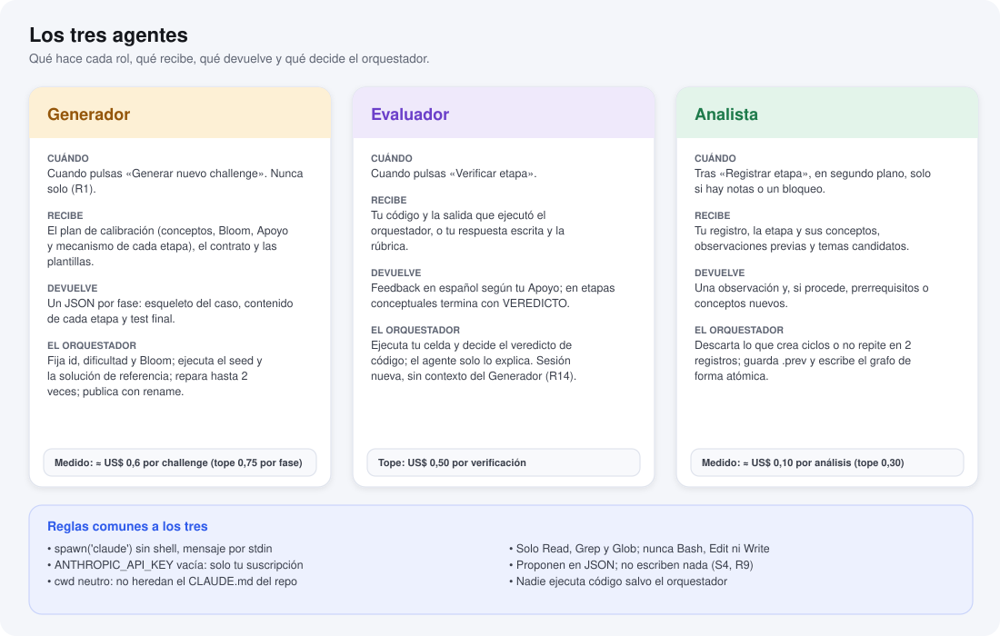

Los tres son procesos independientes de Claude Code con el mismo marco de seguridad:

- **Solo lectura.** Únicamente `Read`, `Grep` y `Glob`; `Bash`, `Edit` y `Write` están denegados. Nadie ejecuta código salvo el orquestador.
- **Proponen, no escriben.** Devuelven JSON; el orquestador valida y es quien escribe. Por eso un agente no puede romper tus datos.
- **Aislados.** Directorio de trabajo neutro (no heredan el `CLAUDE.md` del repo), sesión nueva en cada llamada y el Evaluador nunca comparte contexto con el Generador.
- **Sobre tu suscripción.** `ANTHROPIC_API_KEY` se pasa vacía a propósito: nunca se factura por API.
- **Con tope de gasto.** Cada llamada lleva `--max-budget-usd`. Si se agota, no se aplica nada y se ofrece reintentar.

## Verificar una etapa

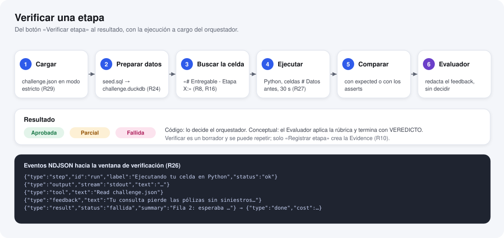

El veredicto de las etapas de código **lo decide el orquestador**, no el modelo: ejecuta la celda con un timeout de 30 s y compara con `expected` (columnas y filas en el mismo orden) o con los `asserts` de la etapa. El Evaluador solo redacta el feedback, ajustado a tu Apoyo, y no puede cambiar el resultado. En las etapas conceptuales, tu respuesta va en una celda de texto y el Evaluador aplica la rúbrica y termina con un `VEREDICTO`.

Verificar es un borrador que puedes repetir cuantas veces quieras; solo **«Registrar etapa»** crea la Evidence. La ventana de verificación muestra en vivo qué está haciendo el sistema, la salida de tu celda y el feedback.

## Pedagogía: Bloom, Apoyo y Nivel

### Taxonomía de Bloom

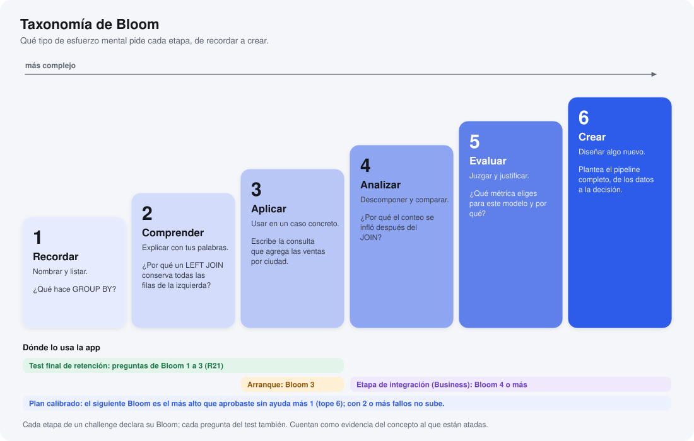

Cada etapa y cada pregunta del test declara su nivel cognitivo. El test final de retención usa Bloom 1 a 3, las etapas de arranque Bloom 3 y la etapa de integración Bloom 4 o más. En el plan calibrado, el siguiente Bloom de un concepto es el más alto que aprobaste sin ayuda más uno; con dos o más fallos no sube hasta que apruebes.

### Apoyo y Nivel

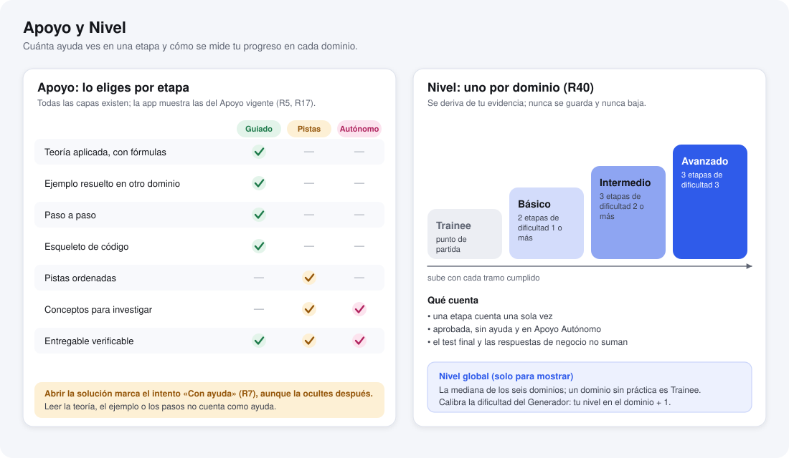

- **Apoyo** (Guiado, Pistas, Autónomo): lo eliges por etapa. El Generador produce *todas* las capas; la app muestra las del Apoyo vigente. Abrir la solución marca el intento «Con ayuda» de forma permanente; leer teoría no.
- **Nivel por dominio** (Trainee, Básico, Intermedio, Avanzado): se deriva de tu evidencia y nunca se guarda ni baja. Cuenta una etapa aprobada, sin ayuda y en Apoyo Autónomo, una sola vez. El nivel global que ves en Inicio es la mediana de los seis dominios, así que pide amplitud.

## El grafo de conocimiento

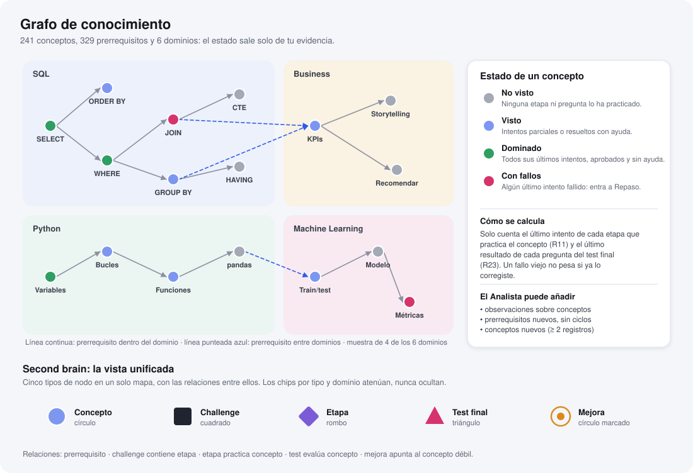

Un **concepto** es un nodo con sus prerrequisitos (pueden ser de otro dominio). Su **estado** se calcula solo con tu evidencia:

| Estado | Significa |
|---|---|
| **No visto** | Ninguna etapa ni pregunta lo ha practicado. |
| **Visto** | Intentos parciales o resueltos con ayuda. |
| **Dominado** | Todos sus últimos intentos, aprobados y sin ayuda. |
| **Con fallos** | Algún último intento fallido; entra en la cola de Repaso. |

Cuenta el **último intento de cada etapa** que practica el concepto y el último resultado de cada pregunta del test final: un fallo antiguo no pesa si ya lo corregiste. El historial completo se conserva y se usa para el diagnóstico.

La vista **second brain** junta cinco tipos de nodo (conceptos, challenges, etapas, tests y mejoras) con sus relaciones. Los filtros por tipo y dominio *atenúan*, nunca ocultan.

### El Analista y el grafo

Tras cada registro con notas o con un bloqueo marcado, el Analista propone tres cosas, de menor a mayor impacto, y el orquestador decide:

1. **Observar:** vincular lo que escribiste con conceptos existentes y dejar un diagnóstico breve. Se ve en la ventana de debilidad.
2. **Enlazar:** añadir un prerrequisito entre dos conceptos existentes, si no crea un ciclo.
3. **Crear:** añadir un concepto nuevo, solo si el tema no está en el catálogo y aparece en **dos registros distintos**; la primera vez queda como candidato.

Los registros sin notas ni bloqueo se omiten sin llamar al agente. Si el Analista falla, el grafo queda idéntico, tu registro sigue guardado y aparece un aviso «Analizar ahora». Antes de cada escritura se guarda una copia en `knowledge-graph.json.prev`.

## Datos y persistencia

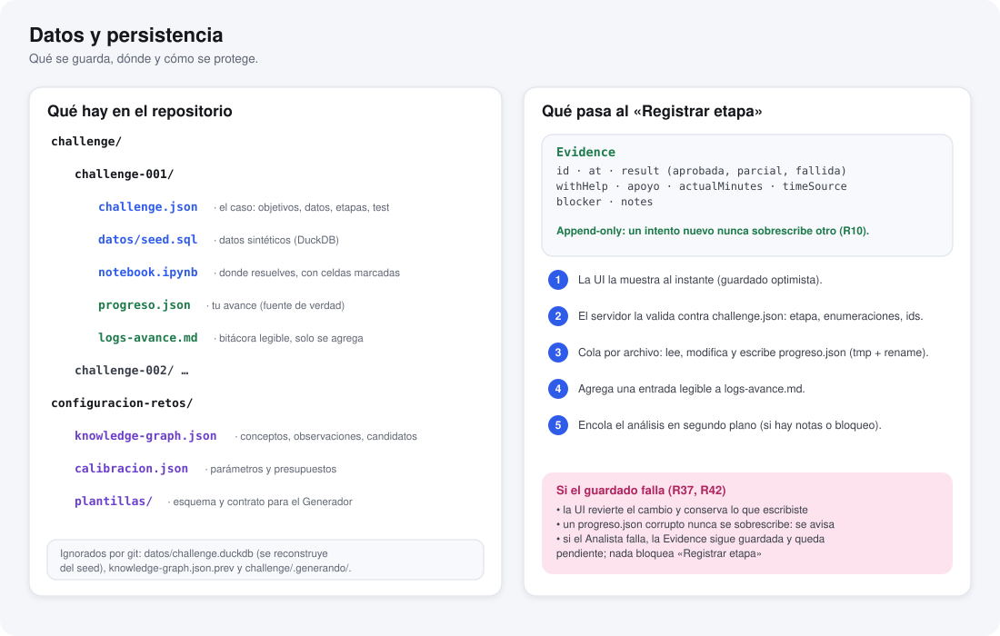

No hay base de datos: todo son archivos versionados por git (Markdown y JSON).

- **`progreso.json`** es la fuente de verdad de tu avance por challenge: inicio, Apoyo por etapa, Evidence, respuestas de negocio y resultados del test. La Evidence es *append-only*.
- **`logs-avance.md`** es una bitácora legible que solo se agrega.
- **`knowledge-graph.json`** es el único almacén del grafo: conceptos, observaciones y candidatos.
- Cada escritura es atómica (archivo temporal y `rename`); un archivo corrupto nunca se sobrescribe, se avisa.
- La interfaz guarda de forma optimista y, si falla, revierte el cambio y conserva lo que escribiste.
- Solo el cronómetro en marcha y los borradores viven en el navegador (`localStorage`).

## Formato de un challenge

El formato es un contrato para los agentes: `configuracion-retos/plantillas/` contiene `challenge.schema.json` (JSON Schema) y las plantillas por tipo de reto (SQL, Python, Matemática, ML y Business). El orquestador valida cada `challenge.json` en modo estricto y rechaza con un mensaje que nombra el campo.

Un challenge se presenta siempre en el mismo orden: **objetivos** (qué busca y qué obtendrás) → **enunciado** → **datos** (diagrama relacional y filas de muestra) → **etapas** (teoría aplicada, ejemplo resuelto en otro dominio, paso a paso, esqueleto, entregable, solución por secciones) → **preguntas de negocio** → **test final**. El texto es Markdown con fórmulas KaTeX; los signos de moneda se escapan como `\$`.

## Empezar

**Necesitas:** Node 22, [uv](https://docs.astral.sh/uv/) (o cualquier gestor de entornos de Python) y [Claude Code](https://claude.com/claude-code) instalado, con sesión iniciada (ejecuta `claude` una vez en una terminal).

```bash
# 1. Dependencias de la app
npm --prefix app install

# 2. Entorno de Python solo para ejecutar los notebooks (DuckDB, pandas, scikit-learn…)
uv venv .venv
uv pip install --python .venv/bin/python -r requirements.txt

# 3. Compilar y abrir la app en http://127.0.0.1:4317
npm run app
```

| Comando | Para qué |
|---|---|
| `npm run app` | Compila el frontend, levanta el orquestador (o `PORT=4400 npm run app`) y abre el navegador. |
| `npm run dev` | Servidor con recarga y Vite con proxy a `/api`. |
| `npm test` | Pruebas (Vitest). |
| `npm run typecheck` | Comprobación de tipos. |

Sin Claude Code las etapas de código siguen dando el resultado automático, pero no hay feedback del Evaluador, ni generación, ni Analista. Añade `?datos=ejemplo` a la dirección para ver la app con datos sintéticos (no se guarda nada).

**Tu primer challenge:** abre **Challenges** y pulsa «Generar nuevo challenge». Verás el plan que calculó el orquestador y, al confirmar, las fases en vivo. Con él ya publicado, resuélvelo en `challenge/challenge-NNN/notebook.ipynb`, verifica cada etapa en la app y regístrala con tus notas.

## Estructura del repositorio

```
.
├── app/
│   ├── server/        orquestador (Fastify): guard, persistence, verify, generator, analyst, agents
│   ├── web/           frontend React + Vite (pantallas, dominio puro, gráficos SVG)
│   ├── shared/        tipos y contratos compartidos entre servidor y frontend
│   └── test/          pruebas (más de 400)
├── challenge/
│   └── challenge-NNN/ challenge.json · datos/seed.sql · notebook.ipynb · progreso.json · logs-avance.md
├── configuracion-retos/
│   ├── knowledge-graph.json   el grafo: conceptos, observaciones, candidatos
│   ├── calibracion.json       parámetros y presupuestos del Generador y el Analista
│   └── plantillas/            esquema y contrato que leen los agentes
├── sdd-project-context/       SDD.md (especificación) y UI-UX.md (sistema visual y pantallas)
├── docs/img/                  diagramas SVG y capturas de este README
└── requirements.txt           entorno de Python de los notebooks (no es parte de la app)
```

## Cómo se construyó: SDD y estándares

El proyecto sigue **desarrollo dirigido por especificación** (*spec-anchored*): primero se actualiza [`sdd-project-context/SDD.md`](sdd-project-context/SDD.md) (épica, historias, requisitos `R1…R42`, criterios de aceptación `AC-R*`) y [`UI-UX.md`](sdd-project-context/UI-UX.md), y después el código. Los criterios de aceptación son la definición de terminado y se escriben como pruebas. Cuando algo contradice la especificación, se corrige la especificación a la vista, no en silencio.

Estándares que no se negocian:

| | |
|---|---|
| **S1** | Persistencia en archivos versionados por git; sin base de datos. |
| **S2** | Los agentes usan `spawn('claude')` sobre la suscripción; nunca `ANTHROPIC_API_KEY` ni facturación por API. |
| **S3** | Cada rol es un proceso hijo independiente con `cwd` neutro. |
| **S4** | Las herramientas de cada agente se declaran explícitamente (permitidas, denegadas y `--settings`). |
| **S5, S6** | `knowledge-graph.json` es el único almacén del grafo y se escribe de forma atómica. |
| **S7** | Todo corre en local; el servidor solo escucha en `127.0.0.1`. |

Además: verificar y generar son operaciones exclusivas (si hay otra en curso, la segunda se rechaza con un 409 en vez de encolarse), el Analista tiene su propia cola serial en segundo plano, el Evaluador no comparte contexto con el Generador y ningún agente ejecuta código.

## Costos medidos

Medidos con tu suscripción en corridas reales (el dólar es el costo que reporta Claude Code por llamada):

| Operación | Costo medido | Tope configurado |
|---|---|---|
| Generar un challenge básico de 3 etapas | ≈ US$ 0,6 | US$ 0,75 por fase |
| Analizar un registro con notas | ≈ US$ 0,10 | US$ 0,30 |
| Registro sin notas ni bloqueo | 0 (no llama al agente) | — |
| Feedback del Evaluador | — | US$ 0,50 por verificación |

Los topes viven en `configuracion-retos/calibracion.json` y se ajustan sin tocar código.

## Estado y límites

Los paquetes del SDD (P0 a P7) están implementados y no quedan deudas de diseño abiertas. Cosas que conviene saber:

- **Un solo usuario, en local.** No hay cuentas, sincronización ni despliegue.
- **El Generador produce datasets DuckDB** con `seedSql` (las etapas de Python leen con `con.sql(...).df()`); los datasets con semilla en Python quedan para más adelante.
- **El costo se midió con un challenge básico.** Conviene revisarlo con uno intermedio o avanzado.
- **El Analista real aún no ha propuesto crear conceptos ni enlazar prerrequisitos:** con muy poca evidencia solo observó, como prevé la regla de recurrencia. Esas dos acciones se probaron con un agente simulado.
- **Los datos de ejemplo** (`?datos=ejemplo`) simulan la verificación, el refuerzo y el inicio de challenges; los challenges reales verifican de verdad.
- **Las fórmulas derivadas** (prioridad de Repaso, estado de concepto, nivel) las ratificó el autor y pueden ajustarse.

---

Hecho por Helio Castillo. La especificación completa, con cada decisión y su porqué, está en [`sdd-project-context/`](sdd-project-context/).
